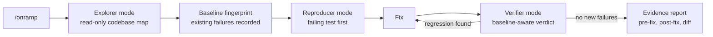

# OnRamp: an IBM Bob kit for joining an unfamiliar codebase

**OnRamp makes IBM Bob prove its code changes, not just make them.**

[](https://youtu.be/DYtMVaG5O8s)
[](https://kniggukniggu-droid.github.io/onramp-evidence/)
[](#how-it-was-built)
[](../.bob/)
[](#tldr)

**Live tools:** [Replay Bob's recorded session](https://kniggukniggu-droid.github.io/onramp-evidence/session.html) · [Reviewer verdict for your PR](https://kniggukniggu-droid.github.io/onramp-evidence/verdict.html) · [Verify the seal](https://kniggukniggu-droid.github.io/onramp-evidence/seal.html) · [Set up OnRamp for your repo](https://kniggukniggu-droid.github.io/onramp-evidence/profile.html)

A drop-in kit that takes a developer from "never seen this repo" to a verified bug fix with sealed evidence, using only Bob-native extension points.

> **Derived from [healthchecks/healthchecks](https://github.com/healthchecks/healthchecks) at commit `0968fa2` (BSD-3-Clause, see [LICENSE](../LICENSE)).  This repository is not affiliated with the Healthchecks project.**

**[Evidence Explorer (live demo)](https://kniggukniggu-droid.github.io/onramp-evidence/)** · **[Pitch deck (PDF)](../docs/deck/OnRamp-pitch-deck.pdf)** · **[Bob's recorded session](../docs/evidence/BOB_SESSION_webhook-205.md)** · **[Bob activity: 491 tool calls, 10 tasks](../docs/evidence/BOB_ACTIVITY_TOTALS.md)**

**The kit is the files in [`.bob/`](../.bob/). Everything outside `.bob/` and `docs/` is upstream Healthchecks, used as the unfamiliar codebase.**

## Judge path in 60 seconds

1. **Sealed brief.** The bug brief was hashed and timestamped before Bob started reproducing the bug: [`benchmark_webhook-205.json`](../docs/onramp/evidence/benchmark_webhook-205.json).
2. **Bob's failing test first.** `AssertionError: 3 != 1` before any fix: [`pre_fix_webhook-205.txt`](../docs/onramp/evidence/pre_fix_webhook-205.txt) (see the disclosure in [Blind fix](#blind-fix--webhook-http-205-bug)).
3. **Bob catches its own regression.** Open [`BOB_SESSION_webhook-205.md`](../docs/evidence/BOB_SESSION_webhook-205.md) and search "22 ERRORs".
4. **Full suite after the fix.** 1,767 tests, 0 regressions, run independently by the team: [`SUITE_FULL_after_fix_independent.txt`](../docs/evidence/SUITE_FULL_after_fix_independent.txt).
5. **Linux reproduction.** The team re-ran the failing test on Linux and got the same failure: [`LINUX_REPRODUCTION_2026-10-19.md`](../docs/evidence/LINUX_REPRODUCTION_2026-10-19.md).
6. **Live classifier.** The [Evidence Explorer](https://kniggukniggu-droid.github.io/onramp-evidence/) runs a baseline-aware classifier demo in the browser. The team wrote it; a CI parity check compares it with `onramp_normalize.py`.

## How it works



## Why teams would use this

- **Onboarding legacy code.** A newcomer runs `/onramp`. Explorer mode and the `map-codebase` skill map the repository read-only before anyone changes it.
- **Reviewer-checkable AI changes.** Every change ships with a pre-fix failure, a post-fix pass, a diff and a report. Reviewers check evidence instead of trusting the agent.
- **Inherited-failure noise removed.** The baseline separates failures that were already there (29 on Windows for Healthchecks) from regressions the change introduced.

## TL;DR

- **Problem:** an AI agent edits an unfamiliar repo and the suite goes red. Is that a regression, or was it already broken? Healthchecks has 1,761 tests and 29 of them already fail on Windows.
- **What OnRamp does:** it turns Bob into an evidence-gated engineer. Bob fingerprints the existing failures first, writes a failing test before any fix, and verifies against the baseline. A newcomer runs it with `/onramp`.
- **Proof:** in a sealed blind test, Bob fixed a real upstream bug. Bob's first fix broke **22** existing tests; Bob caught it in Verifier mode and revised the fix. The revised fix had 0 new failures. Bob's own words are in the [recorded session](../docs/evidence/BOB_SESSION_webhook-205.md) (search "22 ERRORs").
- **Bob wrote it:** by `git blame`, 2,444 of the 2,846 lines in `.bob/` (85.9%) and every application-code change (commits `5f16187`, `786c034`, `e4032c2`) come from commits with the `Generated-by: IBM Bob` trailer.
- **Why it matters for teams:** every AI change ships with a pre-fix failure, a post-fix pass, a diff and a report. Reviewers check evidence instead of trusting the agent.

---

## What the kit is

The reusable kit lives under `.bob/` (plus a per-repository profile in `docs/onramp/`). The Healthchecks case study itself changes application code under `hc/` (the bug fix and the feature).

| Component | Location | Purpose |
|-----------|----------|---------|
| **Explorer mode** | [`.bob/custom_modes.yaml`](../.bob/custom_modes.yaml) | Read-only guide — traces requests, maps layout, answers "where does X live?" before any change |
| **Reproducer mode** | [`.bob/custom_modes.yaml`](../.bob/custom_modes.yaml) | Failing-test-first workflow; instructed not to draft a fix until `pre_fix_<slug>.txt` exists and shows `FAIL` (an instruction, not a tool restriction) |
| **Verifier mode** | [`.bob/custom_modes.yaml`](../.bob/custom_modes.yaml) | Reviews evidence artefacts and gates completion; edits limited to the evidence folder (it can still run commands) |
| **`map-codebase` skill** | [`.bob/skills/map-codebase/SKILL.md`](../.bob/skills/map-codebase/SKILL.md) | Systematic walk of an unfamiliar codebase; writes `docs/onramp/CODEBASE_MAP.md` |
| **`bug-to-test` skill** | [`.bob/skills/bug-to-test/SKILL.md`](../.bob/skills/bug-to-test/SKILL.md) | Turn a bug report into a failing test, step by step |
| **`verify-change` skill** | [`.bob/skills/verify-change/SKILL.md`](../.bob/skills/verify-change/SKILL.md) | Re-run the targeted test, capture output, compute diff, check for regressions |
| **`write-evidence-report` skill** | [`.bob/skills/write-evidence-report/SKILL.md`](../.bob/skills/write-evidence-report/SKILL.md) | Assemble `REPORT_<slug>.md` from the three artefact files |
| **`/onramp` command** | [`.bob/commands/onramp.md`](../.bob/commands/onramp.md) | Guided walkthrough a newcomer runs once; reads `CODEBASE_MAP.md` and summarises the repo |
| **`/evidence` command** | [`.bob/commands/evidence.md`](../.bob/commands/evidence.md) | Assemble or regenerate the evidence report for a given slug |
| **Post-edit test hook** | [`.bob/settings.json`](../.bob/settings.json) + [`.bob/hooks/run-app-tests.mjs`](../.bob/hooks/run-app-tests.mjs) | After any `write_file`/`apply_diff`/`search_and_replace`/`insert_content` on a `.py` file, automatically runs the relevant app-level test suite and prints PASS/FAIL. **Runner feedback only:** it exits 0 on normal input and never blocks the edit (it exits 1 on empty or malformed input; see Known limitations) and does not compare against the baseline; baseline-aware verdicts come from `gen_report.py classify` / `onramp_normalize.py classify` |
| **`gen_report.py`** | [`.bob/gen_report.py`](../.bob/gen_report.py) | Stdlib-only script: `capture-baseline`, `classify` (inherited failures / regressions / fixed / unchanged), `seal-benchmark` (blind envelope before work starts), `attach-patch`, `report` |
| **Evidence artefacts** | [`docs/onramp/evidence/`](../docs/onramp/evidence/) | `baseline.json`, sealed benchmark, pre/post fix outputs, diff, upstream patch, `REPORT_<slug>.md` |
| **Repo profile** | [`docs/onramp/profile.json`](../docs/onramp/profile.json) | The only file that changes between repos — test runner, app root, settings module |

---

## Results on Healthchecks

### Baseline

Running `.venv\Scripts\python.exe manage.py test` on Windows at kit commit `e10db36` (its application code under `hc/`, `templates/` and `static/` is identical to upstream `0968fa2`) gave **1,761 tests, 29 failures**.  All 29 are Windows-only:

- **26** are `hc.integrations.signal` tests — they fail with `AttributeError: module 'socket' has no attribute 'AF_UNIX'`, which does not exist on Windows.
- **2** are `hc.accounts.tests.test_senddeletionscheduled` tests — they fail with `ValueError: Invalid format string` because the strftime format used is Linux-only.
- **1** is `hc.api.tests.test_check_model.CheckModelTestCase.test_get_status_handles_autumn_dst_transition` — fails because time-zone switching does not work on Windows.

These are recorded in [`docs/onramp/evidence/baseline.json`](../docs/onramp/evidence/baseline.json) and classified as *inherited failures* (pre-existing, not introduced by any change).

> **Note:** `baseline.json` records `error_type: "Unknown"` for all 29 entries because the baseline was captured from a `unittest` run without `-v`; the error types above come from direct inspection of the test sources and Windows behaviour.

---

### Blind fix — webhook HTTP 205 bug

**Brief (sealed before the issue-specific work began; Bob had already mapped the repository):** A webhook endpoint that replies with HTTP 205 caused Healthchecks to retry the request three times and mark the integration as failed.  The brief's expectation was "a 2xx response such as 205 means the notification was delivered".  The brief was hashed and recorded in [`docs/onramp/evidence/benchmark_webhook-205.json`](../docs/onramp/evidence/benchmark_webhook-205.json) at 21:05:38 UTC, before Bob started reproducing the bug.

**Workflow:**
1. `seal-benchmark` recorded the brief SHA-256 and timestamp.
2. `bug-to-test` skill wrote `test_webhooks_accept_http_205` — failing (`AssertionError: 3 != 1`, call count instead of 1) — before any fix was written.  Output saved to [`pre_fix_webhook-205.txt`](../docs/onramp/evidence/pre_fix_webhook-205.txt).  **Disclosure:** the failing run is real (session step 19). Bob's first saved copy was UTF-16 because of PowerShell redirection. After the fix was committed, Bob rewrote `pre_fix_webhook-205.txt` by hand from the output it had already observed, without re-running against the unfixed code (session steps 55–59). A Linux re-run by the team on 2026-10-19 reproduced the same `AssertionError: 3 != 1` at the same line ([`LINUX_REPRODUCTION_2026-10-19.md`](../docs/evidence/LINUX_REPRODUCTION_2026-10-19.md)).
3. Reproducer mode wrote the fix (1 line in `hc/api/transports.py`).
   **Bob caught its own regression:** the first attempt, `if not (200 <= r.status_code < 300):`, gave 48 tests with **22 ERRORs**. Bob's recorded words were "These 22 errors are regressions introduced by my fix!" Existing tests use a `MagicMock` status code, and the chained comparison breaks on it. Bob found this in Verifier mode (session steps 27 and 40), then changed the fix to `not in range(200, 300)` (steps 43–46, commit `5f16187`). Bob amended that commit with `--no-edit` (step 48), so `5f16187`'s message still describes the first attempt; the session export is the only record of it. See [`BOB_SESSION_webhook-205.md`](../docs/evidence/BOB_SESSION_webhook-205.md).
4. Verifier mode re-ran the test (PASS), ran the full `hc.integrations.webhook` suite (48 tests, OK) and `hc.api` (431 tests, only the inherited DST failure; session step 47), and generated the evidence report with `gen_report.py report`. That report's original classification was wrong; see the corrected report below.
5. `attach-patch` recorded the upstream maintainer's later fix ([`reference_upstream_0a9bff9.patch`](../docs/onramp/evidence/reference_upstream_0a9bff9.patch)) for comparison.

**Evidence report:** [corrected report, 2026-10-12](../docs/evidence/CORRECTED_REPORT_webhook-205_2026-10-12.md) · [historical report — superseded; contains an incorrect classification from a targeted test run](../docs/onramp/evidence/REPORT_webhook-205.md)

**Honest comparison with the maintainer's fix (commit `0a9bff9`):**

| | This fix | Upstream |
|---|---|---|
| Root cause | Identical | Identical |
| Production change | `not in range(200, 300)` — all 2xx | `not in (200,201,202,204,205)` — adds only 205 |
| Test added | `test_webhooks_accept_http_205` (2 assertions) | `test_it_handles_http_205` (3 assertions + URL check) |
| `CHANGELOG.md` | Not touched | +1 line |

The upstream choice is deliberately conservative: `HttpTransport` is the shared base for ~25 integrations whose APIs return only 200/201/204 on success; accepting 206–299 broadly could silently swallow unexpected partial-content responses.  For the specific 205 bug both fixes are equivalent; for long-term robustness the upstream approach is safer.

---

### Pretty-printed JSON feature — issue #1090

Issue [#1090](https://github.com/healthchecks/healthchecks/issues/1090) asked for JSON ping bodies to be pretty-printed in the ping-detail view.  Commit `786c034` implemented this by passing the parsed JSON through `json.dumps` with `indent=2`, keeping the **Download Original** link byte-for-byte unchanged.  A follow-up commit `e4032c2` added `ensure_ascii=False` after a reviewer noticed that `json.dumps` was escaping non-ASCII characters such as `café` as `\u00e9`.

The pre-fix test ([`pre_fix_non_ascii_json_body.txt`](../docs/onramp/evidence/pre_fix_non_ascii_json_body.txt)) confirmed the failure after the pretty-print change was in place:

```
AssertionError: False is not true : Couldn't find 'café' in the following response
(body contained \u00e9 and \u2705 escape sequences instead of literal UTF-8 characters)
```

---

## Portability — TaskFlow (Flask)

The `.bob/` directory was copied unchanged into a separate Flask project called TaskFlow.  Only [`docs/onramp/profile.json`](../docs/onramp/profile.json) was updated to reflect the Flask test runner and app structure.  All three runs validated the installation, created the profile, captured the baseline, and generated the codebase map; none ran a bug-to-test loop, none used pytest directly, and no kit files were edited in the TaskFlow project.

- **Run 1** exposed Django assumptions baked into the kit: the post-edit hook was hardcoded to `hc/`, output parsing was Django-only, baseline storage used `baseline.txt` instead of `baseline.json`, the Reproducer mode's edit scope was Django-specific, and several skill steps referenced Django conventions.  These were fixed in commits `4facc4b` and `6be3235`.
- **Run 2** found that `unittest` error types were recorded as `"Unknown"` when the run lacked `-v`.  Fixed in commit `8165552`.
- **Run 3** recorded `AssertionError` correctly.  **Known limitations from run 3:** on Windows the profile's test command must use the venv's own Python executable, and failures from `unittest` runs without `-v` lose the module path in the recorded id.

---

## Quick start

**Prerequisites:** IBM Bob (IDE), Python 3.10+, and Node.js 18+ (the post-edit hook is a `.mjs` script). **Supported today:** Django and plain `unittest` projects.

**Drop the kit into another repository.** Copy only `.bob/`. `docs/onramp/` holds Healthchecks-specific evidence and should not be copied.

```bash
cp -R .bob <your-repo>/                      # macOS / Linux / Git Bash
Copy-Item -Recurse .bob <your-repo>\         # Windows PowerShell
```

Create the repository profile from inside the target repo. It detects Django or plain unittest; review the result. Use `python3` on macOS/Linux if `python` is not Python 3.

```bash
cd <your-repo>
python .bob/onramp_normalize.py init-profile --write
```

Then open Bob in the new repository and run:

```
/onramp
```

The `init-profile` step, plus normalizing and classifying a verbose suite run, was tested on untouched Django (Healthchecks 0968fa2) and Flask (TaskFlow) clones: profile created, classified FULL with 0 regressions. The `/onramp` step itself was not re-run in those clean installs, and the generated profile does not yet include the `apps` and `venv_activate` keys that `/onramp` lists. `onramp_normalize.py` is a team-authored addition (24 tests, `.bob/test_onramp_normalize.py`); see [corrections and known limitations](../docs/evidence/CORRECTIONS_2026-10-11.md).

**Run the kit's own tests:**

```bash
python .bob/test_gen_report.py                          # IBM Bob's generator tests (65)
cd .bob && python -m unittest test_onramp_normalize     # the team's normalizer tests (24)
```

**Run the Healthchecks suite (Windows):**

```bash
.venv\Scripts\python.exe manage.py test
# Expected: 1761 tests, 29 known Windows-only failures (see baseline.json)
```

**Capture a fresh baseline:**

```bash
python .bob/gen_report.py capture-baseline
```

---

## How it was built

IBM Bob (IDE and Bob Shell) implemented the original OnRamp kit (modes, skills, commands, hook, `gen_report.py`), the Healthchecks fix and feature, and the recorded engineering iterations; its commits end with `Generated-by: IBM Bob`. The team directed Bob, independently verified its work, and — after Bob's 180-Bobcoin allowance was exhausted — authored a separately attributed normalization/bootstrap module (`.bob/onramp_normalize.py` and its tests) plus the public presentation artifacts (pitch deck, Evidence Explorer, corrections and corrected report). Commit messages and evidence records distinguish these contributions.

Full design rationale and sub-task breakdown: [`docs/onramp/PLAN.md`](../docs/onramp/PLAN.md).

---

## Roadmap

Planned, not done:

- A `PreToolUse` gate that blocks production edits until a failing-test artefact exists (reproduce-first enforced, not only instructed).
- Fail-closed CLI exit codes: `classify` prints its verdict and exits non-zero on regressions or INCONCLUSIVE runs.
- A pytest adapter for profiles, parsing and classification.
- Structured per-edit hook results that reach Bob, instead of a PASS/FAIL line on `PostToolUse` stdout.

---

## Known limitations

- Corrections to earlier claims: [`CORRECTIONS_2026-10-11.md`](../docs/evidence/CORRECTIONS_2026-10-11.md).
- The 1,767-test full-suite run (9.6 s, 0 regressions; log: [`SUITE_FULL_after_fix_independent.txt`](../docs/evidence/SUITE_FULL_after_fix_independent.txt)) the clean-install re-runs and the [Linux reproduction](../docs/evidence/LINUX_REPRODUCTION_2026-10-19.md) were independent checks by the team, not by Bob. Bob's own verify step ran `hc.integrations.webhook` and `hc.api`.
- An independent audit on 2026-10-19 found these open defects in Bob's kit. They are not fixed, because Bob's allowance is exhausted:
  - The TaskFlow runs validated install, profile, baseline and map. None ran a bug-to-test loop.
- The post-edit hook tests only the edited file's app. On Bob's broken first fix (an edit in `hc/api`), it would have run `hc.api`, not `hc.integrations.webhook`, where the 22 errors were. Bob's explicit Verifier run caught them.
- IBM's lifecycle-hooks documentation says `PostToolUse` stdout is ignored, so the hook's PASS/FAIL line may not reach Bob. 
- `gen_report.py classify` does not print its verdict and always exits 0: `classify_run()` computes INCONCLUSIVE for crashed or partial runs, but the command prints only the counts. Treat `NOT RUN > 0` as no verdict. `gen_report.py report` ticks "no new failures" when regression data is `N/A`. Treat the corrected reports and `onramp_normalize.py classify` (fail-closed) as authoritative.
- Mode rules are instructions, not enforcement. In the recorded session, Bob ran `git stash`, `git checkout` or `git commit` 11 times in Reproducer and Verifier modes (steps 23–74), which the mode text forbids, and switched itself to Agent mode when Verifier refused a production edit (steps 45 and 89). Roadmap: a `PreToolUse` gate that blocks production edits until a failing-test artefact exists.
- pytest is not supported. `init-profile` writes a plain `unittest` profile for any repository without `manage.py`.
- Feature #1090 re-serializes JSON for display, so duplicate keys show only the last value and very high-precision floats are shown rounded (for example `0.12345678901234567890` shows as `0.12345678901234568`). **Download Original** still serves the exact bytes.
